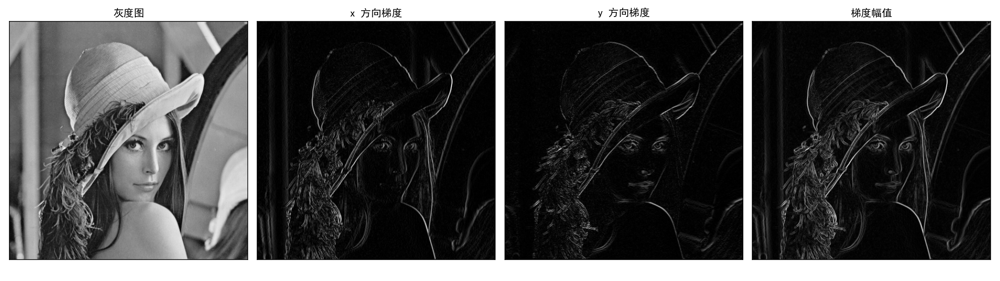
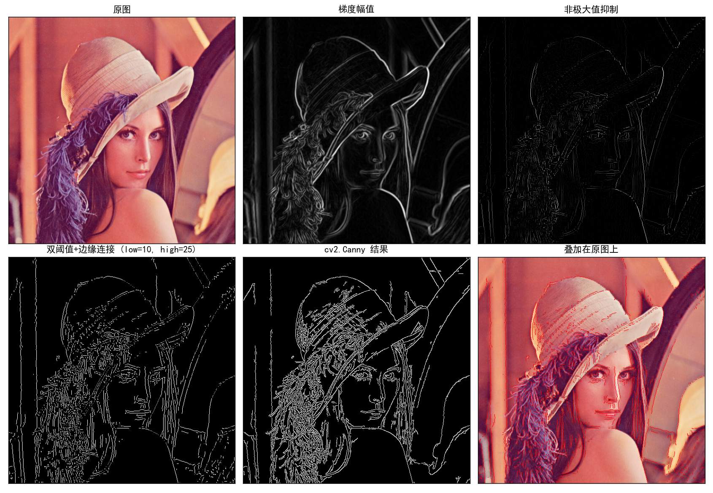
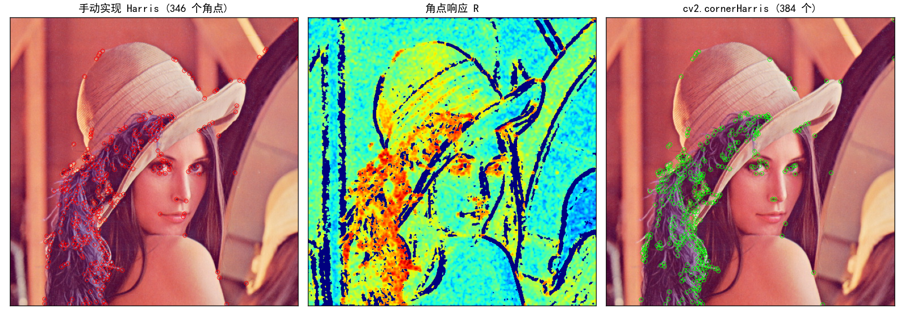
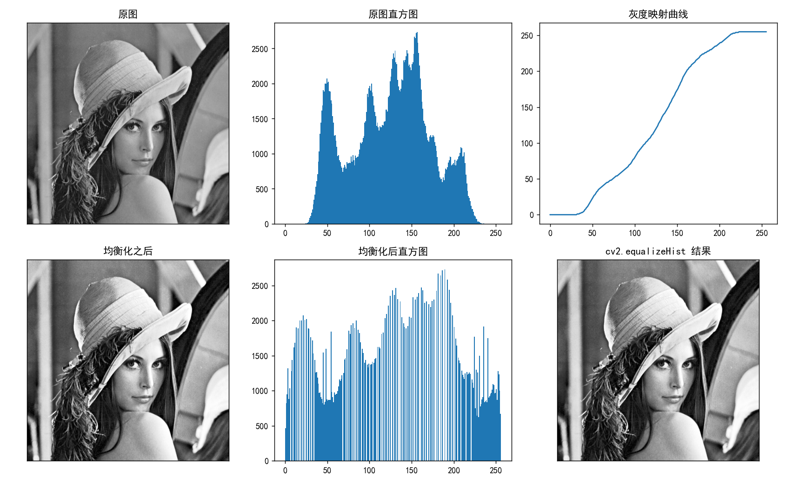
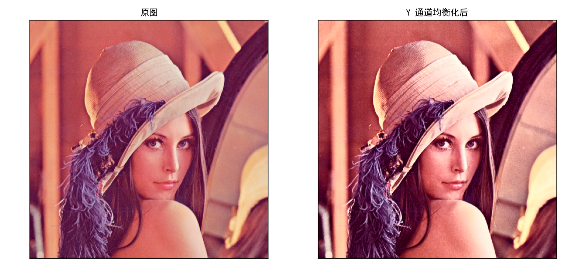

# 作业三 边缘检测与角点检测

## 环境

Ubuntu 22.04 + python3.10，opencv 用 pip 装的：

```bash
pip install opencv-python matplotlib numpy
```

## 运行

```bash
cd hw3
python sobel.py
python canny.py
python harris.py
python hist_eq.py
```

四个脚本互相独立，图都存到 `results/`，测试图是 `images/lena.jpg`，512x512。

## 代码结构

- `sobel.py` —— 任务1。手写了 Sobel 的 x、y 两个卷积核，用 `cv2.filter2D` 滤波，算了梯度幅值，四个子图分别是灰度图、x 梯度、y 梯度、幅值。
- `canny.py` —— 任务2。完整的 Canny 都自己实现，没有调 `cv2.Canny`（只是最后放一张 cv2 的结果做对照）。里面分成几个函数：
  - `gaussian_kernel` / `conv2d`：前面作业里写的高斯核和卷积，这次卷积改成复制边缘填充；
  - `canny`：先高斯模糊，再用 Sobel 算 gx、gy，幅值归一化到 0-255，然后做非极大值抑制，最后双阈值加边缘连接。非极大值抑制是按梯度方向分成水平、垂直、两个对角四类，各取两个邻居比较；边缘连接用栈从强边缘点往外扩，8 邻域里的弱边缘就连上。
- `harris.py` —— 任务3。Sobel 求 Ix、Iy，然后算 Ix²、Iy²、Ixy，用 5x5 高斯窗口做加权求和，R = det - k·trace²，k 取 0.04。之后用 5x5 的膨胀找局部极大值，再卡 0.01·Rmax 的阈值。图上红圈是手动实现的，绿圈是 `cv2.cornerHarris` 的结果（cv2 那边没做非极大值抑制，会出来一大片，我给它补了一下再对比）。
- `hist_eq.py` —— 任务4。用 `np.bincount` 统计直方图，求累计分布，按公式搭一个灰度映射表，再用表查一遍。彩色图是把 BGR 转到 YCrCb，只对 Y 通道做均衡化。

## 结果

任务1，Sobel：



任务2，Canny。阈值取 low=10、high=25（幅值已经归一化到 0-255），自己写的出来 14045 个边缘点，`cv2.Canny` 用 50/120 出来 25424 个：



任务3，Harris。手动实现检测到 346 个角点，`cv2.cornerHarris` 同一个阈值下是 384 个：



任务4，直方图均衡化，和 `cv2.equalizeHist` 的结果逐像素比过，最大差异是 0：



彩色图的 Y 通道均衡化：



## 遇到的问题

- 最早的 Canny 阈值给高了，边缘断断续续，后来把幅值归一化到 0-255 之后重新调的。
- 梯度方向要处理成 0-180 度，不然 NMS 判断方向的时候会分不清正负。
- Harris 的 R 值范围特别大（±1e9），直接 imshow 出来基本全黑，画热力图之前取了个 log。
